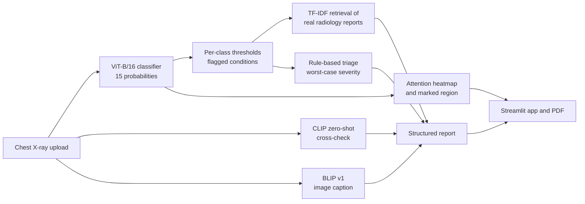

# Explainable Chest X-Ray Diagnostic Assistant

**AI-assisted screening support for chest radiographs: classification, visual explanation, a report grounded in real radiology text, and a triage recommendation. Inference runs on a CPU.**

Built for clinics that have no radiologist on site. A health worker uploads a chest X-ray and gets back what the model found, where in the image it looked, a readable report, and how urgently the patient should see a doctor.

> **⚠️ Not a medical device.** This is a research and teaching prototype. It has not been clinically validated and must not be used to diagnose, treat, or exclude any condition. Every output must be reviewed by a qualified clinician. Do not upload identifiable patient data to any public deployment of this app.

<!-- 📸 PASTE SCREENSHOT: the full app after an X-ray has been analysed.
     Save it as docs/images/01_app_overview.png -->


**Demo video:** [add link here]  |  **Project report / paper:** [add link here]

---

## Contents

1. [What it does](#what-it-does)
2. [Results](#results)
3. [How it works](#how-it-works)
4. [Quick start](#quick-start)
5. [Detailed installation](#detailed-installation)
6. [Using the app](#using-the-app)
7. [Offline use](#offline-use)
8. [Reproducing the training](#reproducing-the-training)
9. [Repository structure](#repository-structure)
10. [Limitations](#limitations)
11. [Roadmap](#roadmap)
12. [Datasets and references](#datasets-and-references)
13. [Acknowledgements and license](#acknowledgements-and-license)

---

## What it does

For each uploaded chest X-ray the app produces:

| Output | What it is |
|---|---|
| **Findings** | Probabilities for 15 labels (14 thoracic conditions + "No Finding") from a fine-tuned Vision Transformer. Conditions above their own tuned threshold are flagged. |
| **Visual explanation** | An attention heatmap and a red-outlined "marked region" showing where the model looked. |
| **Report** | Text for each top finding, retrieved from real radiologist-written reports (Indiana University / OpenI) by TF-IDF similarity, plus general precautions. |
| **Cross-checks** | A zero-shot CLIP opinion and a BLIP v1 image caption, shown as supplementary evidence. |
| **Triage** | A rule-based urgency level: Routine, Soon, Urgent, or Immediate. |
| **PDF report** | A downloadable report with patient details, the three images, findings, triage, precautions, and a technical appendix for clinical staff. |

<!-- 📸 PASTE SCREENSHOT: the three image panels side by side (Original | Heatmap | Marked region).
     Save it as docs/images/02_three_panels.png -->


<!-- 📸 PASTE SCREENSHOT: the triage banner and the "Generated report" text.
     Save it as docs/images/03_report_and_triage.png -->


<!-- 📸 PASTE SCREENSHOT: the "Cross-Verification" section (CLIP + BLIP) and the flagged-conditions caption.
     Save it as docs/images/04_cross_verification.png -->


### Example output

From the NIH sample image `00000032_001.png`, whose ground-truth labels are `Cardiomegaly | Edema | Effusion` (abridged; the model flagged all three):

```text
## AI-Assisted Findings
- Effusion: findings consistent with pleural effusion (confidence 44.9%)
- Cardiomegaly: cardiac silhouette enlargement (cardiomegaly) (confidence 34.9%)
- Edema: findings consistent with pulmonary edema (confidence 15.6%)

Primary finding region (attention-based): upper left lung field

## Similar Documented Patterns
- Effusion: Normal cardiac contour. Right sided pleural effusion. Clear left lung. ...
- Cardiomegaly: Cardiomegaly. No pneumothorax or pleural effusion. Clear lung bilaterally. ...

## Triage
Soon -- Please have a clinician review within the next few days.
(Note: model confidence is low -- please verify.)
```

This was a favourable case. The precision figures below show that the model also raises false alarms on other images. The current version details only the top two findings in the report and lists any others in a short note, while triage still considers every flagged condition.

---

## Results

### Classifier (ViT-B/16, 15 labels)

Evaluated on the **official NIH ChestX-ray14 test split (25,596 images)**, which was never used for training or threshold tuning.

| Metric | Value |
|---|---|
| Mean AUROC, 15 labels | **0.788** |
| Mean AUROC, the 14 diseases only (comparable to CheXNet's setup) | **0.793** |
| Macro precision / recall / F1 at the tuned thresholds | 0.295 / 0.392 / 0.327 |

AUROC is the headline metric. It does not depend on a threshold and is not distorted by class imbalance. The accuracy figures in the table below are inflated by the many easy negatives (for example Hernia: 0.994 accuracy but 0.108 F1), so do not read them as overall quality.

| Condition | AUROC | Accuracy | Precision | Recall | F1 | Test support |
|---|---|---|---|---|---|---|
| No Finding | 0.728 | 0.667 | 0.555 | 0.680 | 0.611 | 9,861 |
| Atelectasis | 0.761 | 0.799 | 0.314 | 0.483 | 0.381 | 3,279 |
| Cardiomegaly | 0.889 | 0.953 | 0.428 | 0.395 | 0.411 | 1,069 |
| Effusion | 0.821 | 0.814 | 0.489 | 0.529 | 0.508 | 4,658 |
| Infiltration | 0.699 | 0.596 | 0.340 | 0.739 | 0.466 | 6,112 |
| Mass | 0.797 | 0.917 | 0.376 | 0.327 | 0.350 | 1,748 |
| Nodule | 0.720 | 0.898 | 0.239 | 0.280 | 0.258 | 1,623 |
| Pneumonia | 0.713 | 0.943 | 0.066 | 0.123 | 0.086 | 555 |
| Pneumothorax | 0.844 | 0.875 | 0.416 | 0.494 | 0.452 | 2,665 |
| Consolidation | 0.751 | 0.799 | 0.169 | 0.468 | 0.248 | 1,815 |
| Edema | 0.847 | 0.916 | 0.186 | 0.397 | 0.254 | 925 |
| Emphysema | 0.870 | 0.948 | 0.393 | 0.409 | 0.401 | 1,093 |
| Fibrosis | 0.814 | 0.974 | 0.180 | 0.145 | 0.161 | 435 |
| Pleural Thickening | 0.768 | 0.895 | 0.156 | 0.305 | 0.206 | 1,143 |
| Hernia | 0.803 | 0.994 | 0.111 | 0.105 | 0.108 | 86 |
| **Macro average** | **0.788** | **0.866** | **0.295** | **0.392** | **0.327** | |

Precision, recall and F1 use the per-class thresholds in `models/thresholds.json`, chosen on the validation split to maximise F1. Accuracy here is label-based accuracy averaged over the 15 labels. It is not the much stricter "all 15 labels correct" accuracy.

**Reading these numbers honestly:** the model ranks cases reasonably (AUROC) but is imprecise at a fixed threshold, especially for rare conditions. Pneumonia (F1 0.086) is the weakest. Treat flagged findings as prompts for a clinician to look, not as conclusions.

### Comparison with CheXNet

<!-- This chart is generated for you: docs/images/auroc_vs_chexnet.png (already in the repo folder you were given) -->


CheXNet's mean AUROC over the same 14 diseases is 0.841 (Rajpurkar et al., 2017). This model is about 5 points lower on average and higher on Fibrosis. The two used different training and evaluation setups, so treat the comparison as indicative. This model was trained for 6 epochs on one free Kaggle GPU.

### Training

<!-- This chart is generated for you: docs/images/training_curve.png -->


The checkpoint from epoch 5 (validation mean AUROC 0.8227) was kept. Validation AUROC is higher than test AUROC (0.788). The test split is the figure to quote.

---

## How it works



### 1. Classification: ViT-B/16

- `torchvision` ViT-B/16, ImageNet-pretrained, **fully fine-tuned** (all parameters trainable) on the NIH ChestX-ray14 training split.
- Input: grayscale X-ray resized to 224×224, replicated to 3 channels, ImageNet-normalised.
- Output: 15 sigmoid probabilities (multi-label). Loss: `BCEWithLogitsLoss` with no class weighting.
- Each condition has its own threshold, tuned on the validation split to maximise F1 (`models/thresholds.json`).

### 2. Explanation: attention, not Grad-CAM

The heatmap is the **[CLS] token's attention over the 14×14 image patches** from the last transformer block. It is not CNN-style Grad-CAM. In an earlier ViT-B/32 prototype, gradient-weighted activations from the last block had no spatial variation at all (the heatmap came out flat), so the project switched to attention. Gradient-based Grad-CAM was not re-tested on the final B/16 model. The "marked region" is a red contour around the area where the normalised attention exceeds 0.5. Attention shows where the model looked. It is not proof that this region caused the prediction, and it can land on non-anatomical markers.

### 3. Report: retrieval, not free-form generation

For each displayed finding the system takes the label's synonyms (for example "pleural effusion" for Effusion), keeps the IU/OpenI reports whose problem labels match, and returns the report with the highest TF-IDF cosine similarity to the synonyms. The `XXXX` de-identification placeholders are removed and the text is cut at a sentence boundary. Because the text is retrieved rather than generated, it is always real clinical wording. It is a similar documented case, not a description of your image.

### 4. Cross-checks

- **CLIP** (`openai/clip-vit-base-patch32`, zero-shot): the image is compared against one hand-written sentence per condition (for example "a chest x-ray showing pneumothorax") and a softmax over the 15 sentences gives its opinion. CLIP is trained on everyday photos, so it is weak on X-rays: in the few examples run, its top matches were only 13 to 19%, against a 6.7% random baseline. The report says plainly when CLIP disagrees. Disagreement is not evidence that the ViT is wrong.
- **BLIP v1** (`Salesforce/blip-image-captioning-base`): an unconditioned general image caption. It is **BLIP, not BLIP-2.** BLIP-2 needs a language model of at least 3.7 billion parameters (about 15 GB of RAM just to load in fp32), which does not fit CPU-only use. BLIP v1 was trained on natural photos, so its captions are generic ("a chest with a large, open lung") and are shown as context only.

### 5. Triage: a rule table, deliberately not a model

Each condition has a fixed base severity. The report uses the **most severe** flagged condition, so a severe finding ranked third by confidence still drives the recommendation.

| Tier | Meaning | Conditions mapped to it |
|---|---|---|
| **Routine** (0) | No urgent action indicated from this image alone | No Finding |
| **Soon** (1) | Clinician review within a few days | Nodule, Atelectasis, Pleural Thickening, Infiltration, Fibrosis |
| **Urgent** (2) | See a doctor within 24 hours | Mass, Consolidation, Effusion, Pneumonia, Cardiomegaly, Emphysema, Edema, Hernia |
| **Immediate** (3) | Seek immediate medical attention | Pneumothorax |

**Low-confidence rule:** if a flagged condition's probability is below 0.5, its severity drops one tier (never below "Soon"), and the report notes that confidence is low. Several thresholds are below 0.5, so this note appears often.

The severity values are design choices made for this prototype. They have **not** been validated by clinicians. Probabilities are raw model outputs and their calibration has **not** been evaluated, so a displayed "confidence" is not a calibrated probability.

---

## Quick start

Windows, Python 3.x, about 14 GB RAM (the machine this was tested on). No GPU is needed.

```bat
git clone https://github.com/<your-username>/<repo-name>.git
cd <repo-name>
python -m venv venv
venv\Scripts\activate
pip install -r requirements.txt
```

Then download the model files (see [Model files](#model-files)) into `models\`, and run once with internet to cache CLIP and BLIP:

```bat
cd src
python download_models.py
cd ..
streamlit run app\app.py
```

The app opens at http://localhost:8501.

---

## Detailed installation

### Requirements

- Windows 10/11 (developed here with Python 3.13 in a virtual environment). macOS and Linux have not been tested.
- About 14 GB of RAM was available on the test machine. The minimum has not been measured.
- Internet for the one-time setup only.

### Model files

These are too large for git, so they are published as assets on the **[Releases page](https://github.com/<your-username>/<repo-name>/releases)**. Download them into `models\`:

| File | Size (approx.) | What it is |
|---|---|---|
| `chest_classifier.pt` | 330 MB | Trained ViT-B/16 weights and the label list |
| `thresholds.json` | small | Per-class thresholds (committed to the repo) |
| `report_index.pkl` | see release | TF-IDF index over the 7,426 IU/OpenI reports |

If you prefer to build the report index yourself from the IU/OpenI CSVs (`indiana_reports.csv` and `indiana_projections.csv`):

```bat
cd src
python report_index.py --reports PATH\TO\indiana_reports.csv --projections PATH\TO\indiana_projections.csv
```

The expected last line is `Built index over 7426 reports -> ...\models\report_index.pkl`.

### CLIP and BLIP weights

```bat
cd src
python download_models.py
```

This downloads about 1.6 GB once (CLIP about 600 MB, BLIP about 1 GB) into the Hugging Face cache. A symlink warning on Windows is harmless.

---

## Using the app

```bat
run_app.bat
```

or manually: `venv\Scripts\activate` then `streamlit run app\app.py`.

1. Upload a chest X-ray (PNG or JPG).
2. Optionally open **Patient details** and fill in name, age, gender, case ID and notes. These are included only in the PDF.
3. Read the three image panels, the triage banner and the generated report.
4. Click **Generate Downloadable PDF Report**, then **Download Report (PDF)**.

<!-- 📸 PASTE SCREENSHOT: page 1 of a generated PDF report.
     Save it as docs/images/05_pdf_page1.png -->


<!-- 📸 PASTE SCREENSHOT: page 2 of the PDF (technical notes for clinical staff).
     Save it as docs/images/06_pdf_technical.png -->


Command-line use, without the web app:

```bat
cd src
python inference.py --image PATH\TO\xray.png
```

The first analysis after launch is slower because the models load once. Later ones reuse them.

---

## Offline use

The ViT classifier loads from `models\chest_classifier.pt` and does not download anything. After the one-time `download_models.py`, CLIP and BLIP load from the local cache. `run_app.bat` sets `HF_HUB_OFFLINE=1` and `TRANSFORMERS_OFFLINE=1` to forbid network access.

If CLIP or BLIP is not cached, the app prints `[warning] ... skipped` and continues without the cross-check section. The classifier, heatmap, report and triage still work.

> **Offline verification status:** CPU inference is tested. Full offline operation (network disabled) has **not yet been verified** on a clean machine. Update this line once you have run the offline test from the Deployment Guide, for example: "Verified offline on `<date>` on `<machine>`."

---

## Reproducing the training

Training needs a GPU, so it ran on a free Kaggle notebook, not locally.

1. New Kaggle notebook. Settings: Accelerator GPU, Internet on.
2. **Add Data**: search "NIH Chest X-rays" and add `nih-chest-xrays/data`.
3. Paste `kaggle/train_vit_kaggle.py` into one cell and run it.
4. Download `chest_classifier.pt`, `thresholds.json` and `test_metrics.json` from `/kaggle/working/`.

| Setting | Value |
|---|---|
| Model | torchvision ViT-B/16, ImageNet-1K weights, new 15-way linear head |
| Fine-tuning | Full (all parameters trainable) |
| Data | NIH ChestX-ray14, 112,120 images |
| Split | Official `test_list.txt` (25,596) kept as test. `train_val_list.txt` (86,524) split by patient, with seed 42, into 77,994 train and 8,530 validation. |
| Loss | `BCEWithLogitsLoss`, no class weights |
| Optimiser | AdamW, weight decay 0.05 |
| Schedule | OneCycleLR, max LR 1e-4, 10% warm-up, 6 epochs |
| Batch size | 64, mixed precision when CUDA is available |
| Augmentation | `RandomResizedCrop(224, scale=(0.85, 1.0))` for training, plain resize for evaluation |
| Checkpoint | Best validation mean AUROC (epoch 5) |
| Time | About 23 to 26 minutes per epoch on the Kaggle GPU |

Mean AUROC is the unweighted mean of per-label binary AUROCs (`sklearn.metrics.roc_auc_score`), computed only for labels with both positive and negative examples.

To compute the precision/recall/F1 table, run `kaggle/addendum_same_session.py` as a new cell in the same Kaggle session. Use `kaggle/addendum_standalone.py` in a fresh session. It needs the checkpoint and thresholds uploaded as a Kaggle Dataset.

---

## Repository structure

```text
.
├── app/
│   └── app.py                  Streamlit web app
├── src/
│   ├── paths.py                Resolves models/ and outputs/ from the project root
│   ├── dataset.py              15-label list and image transforms
│   ├── model.py                ViT-B/16 definition
│   ├── gradcam.py              Attention heatmap and marked region
│   ├── inference.py            End-to-end pipeline (start here)
│   ├── report_generator.py     Report assembly, precautions
│   ├── report_index.py         Builds the TF-IDF index from IU/OpenI
│   ├── triage.py               Severity table and triage rules
│   ├── clip_verify.py          Zero-shot CLIP cross-check
│   ├── blip_caption.py         BLIP v1 captioning
│   ├── report_pdf.py           PDF report builder
│   └── download_models.py      One-time CLIP/BLIP download
├── kaggle/
│   ├── train_vit_kaggle.py     Full-dataset GPU training script
│   ├── addendum_same_session.py
│   └── addendum_standalone.py  Precision/recall/F1 evaluation
├── docs/images/                Screenshots and charts used in this README
├── models/                     Weights and index (not in git, see Releases)
├── data/                       Datasets (not in git)
├── outputs/                    Generated at runtime (not in git)
├── run_app.bat                 Launcher with offline mode forced on
├── requirements.txt
└── README.md
```

---

## Limitations

- **Class imbalance:** rare conditions have few training examples, so precision is low (macro F1 0.327; Pneumonia F1 0.086). Expect false alarms and misses.
- **Calibration not evaluated:** displayed confidence values are raw outputs. The low-confidence triage rule depends on them.
- **Single-source data:** NIH ChestX-ray14 comes from one health system, and the labels were extracted from reports by text mining, not read from the images by radiologists. No external validation has been done.
- **Attention is not causation:** the heatmap can land on markers or artefacts, and the region label is a coarse quadrant ("upper left lung field").
- **Retrieved report text** describes a similar documented case. It is not a description of the uploaded image.
- **CLIP is weak on X-rays,** and **BLIP v1 captions are generic.** Both are supplementary.
- **Triage severities are unvalidated** design choices, and precautions are general, non-prescriptive advice.
- **Single-user design:** the app saves each upload to one shared filename, so simultaneous users could overwrite each other. Do not expose it publicly as a multi-user service.
- **CPU speed:** BLIP captioning in particular can take several seconds per image on a CPU.

---

## Roadmap

Planned or possible next steps, none of which is done yet:

- Evaluate calibration (Brier score, expected calibration error, reliability diagrams).
- Test on an external dataset such as IU/OpenI.
- Swap generic CLIP for a medically pretrained model such as BiomedCLIP.
- Parameter-efficient (LoRA) fine-tuning of a larger vision-language model on cloud GPU for report generation.
- Re-tune thresholds or calibrate probabilities, then revisit the low-confidence rule.
- Unique upload filenames for safe multi-user hosting.

---

## Datasets and references

- **NIH ChestX-ray14**: X. Wang et al., *ChestX-ray8: Hospital-scale chest X-ray database and benchmarks on weakly-supervised classification and localization of common thorax diseases*, CVPR 2017. Used for training and evaluation.
- **Indiana University Chest X-ray collection (OpenI)**: D. Demner-Fushman et al., *Preparing a collection of radiology examinations for distribution and retrieval*, JAMIA 2016. Used only for retrieved report text, not for classifier training.
- **ViT**: A. Dosovitskiy et al., *An Image is Worth 16x16 Words*, ICLR 2021.
- **CLIP**: A. Radford et al., *Learning Transferable Visual Models From Natural Language Supervision*, ICML 2021.
- **BLIP**: J. Li et al., *BLIP: Bootstrapping Language-Image Pre-training*, ICML 2022.
- **CheXNet**: P. Rajpurkar et al., *CheXNet: Radiologist-Level Pneumonia Detection on Chest X-Rays with Deep Learning*, arXiv:1711.05225, 2017. Source of the published AUROCs in the comparison chart.

Please check each dataset's own terms of use before reusing the data.

---

## Acknowledgements and license

Developed as a specialization project in Natural Language Processing at KLH, under the guidance of **[Instructor Name]**.

**Author:** [Your Name], [your LinkedIn / email]

**License:** [choose a license and add a LICENSE file, for example MIT]. The license covers this code only. The datasets and pretrained models keep their own licenses.
